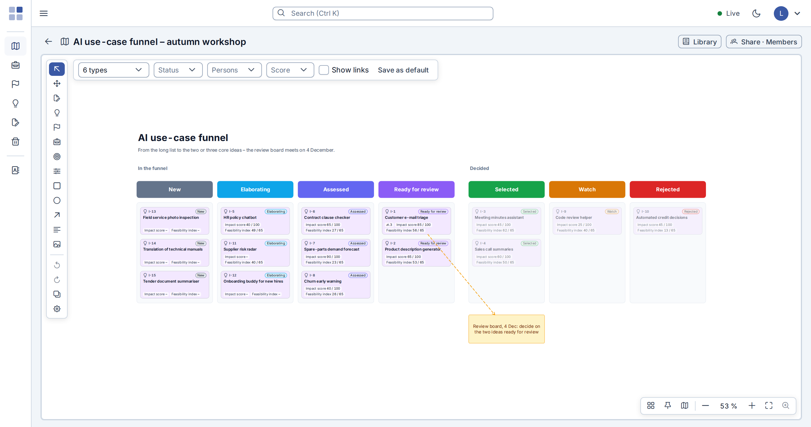
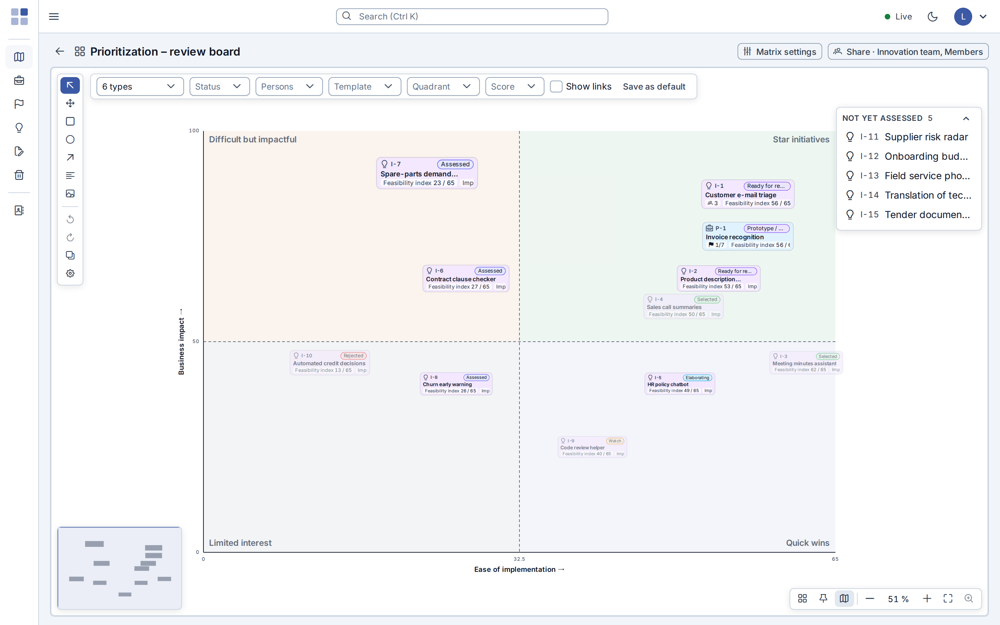
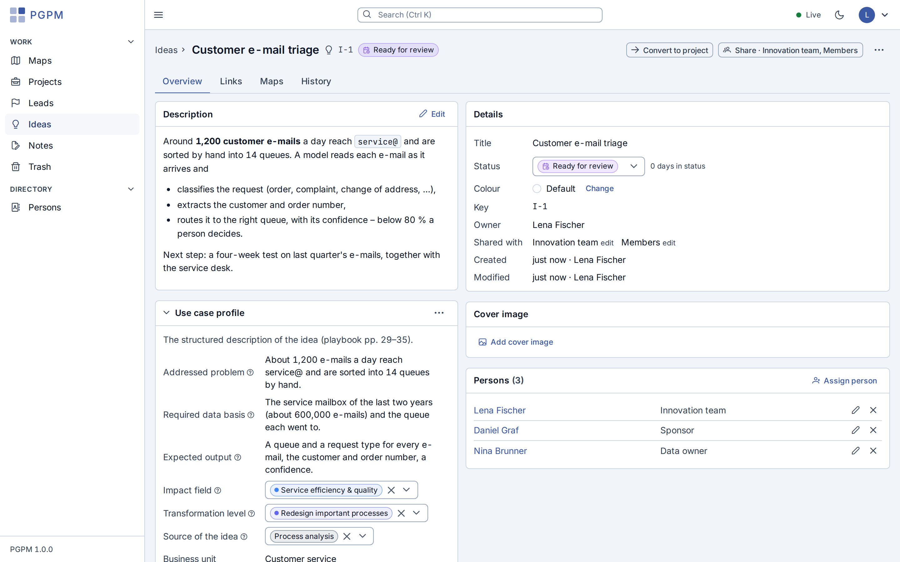
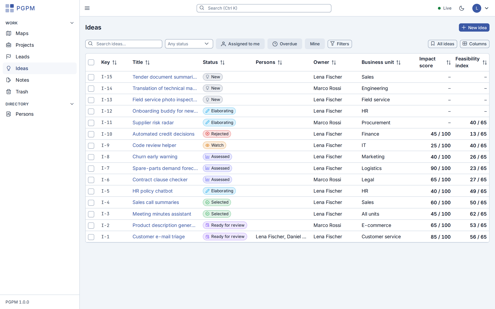
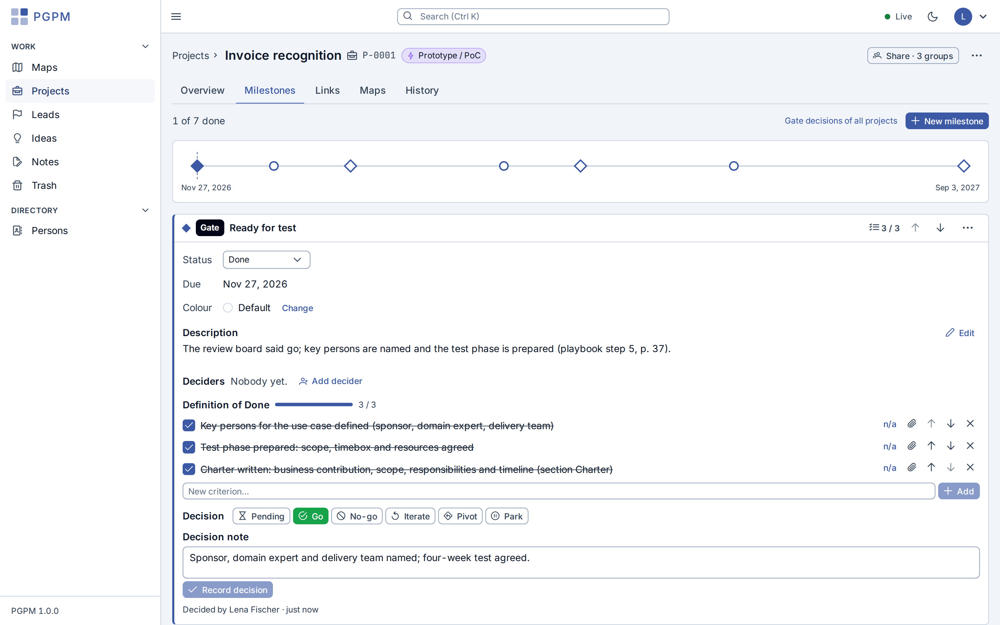
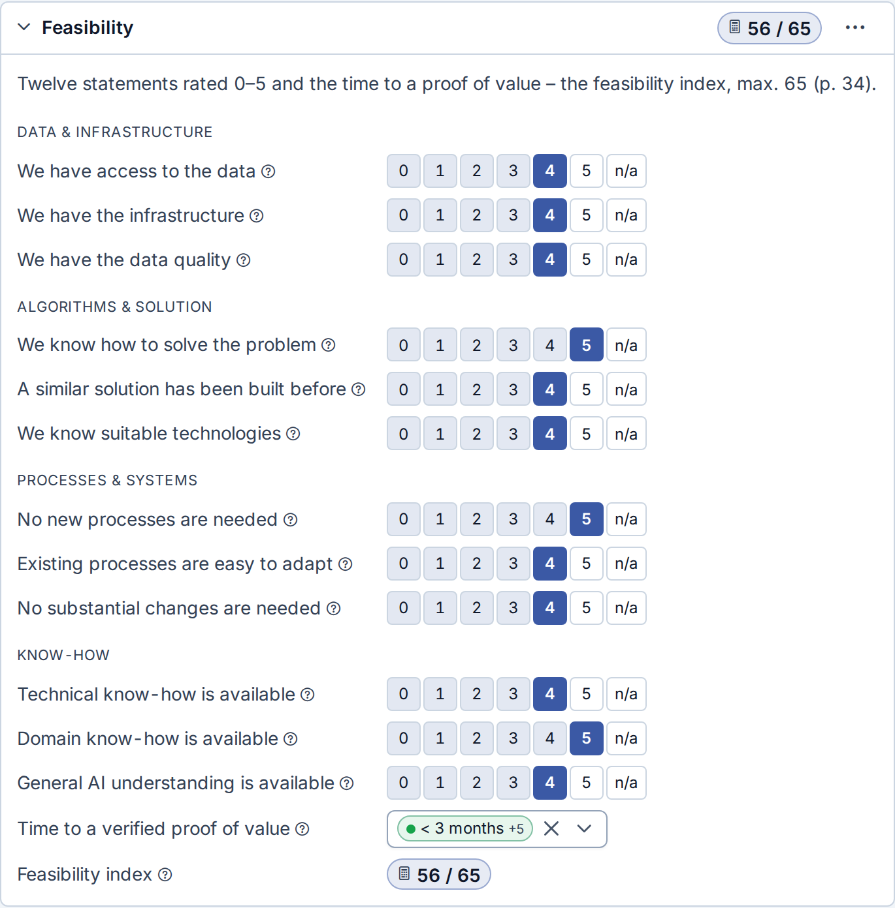
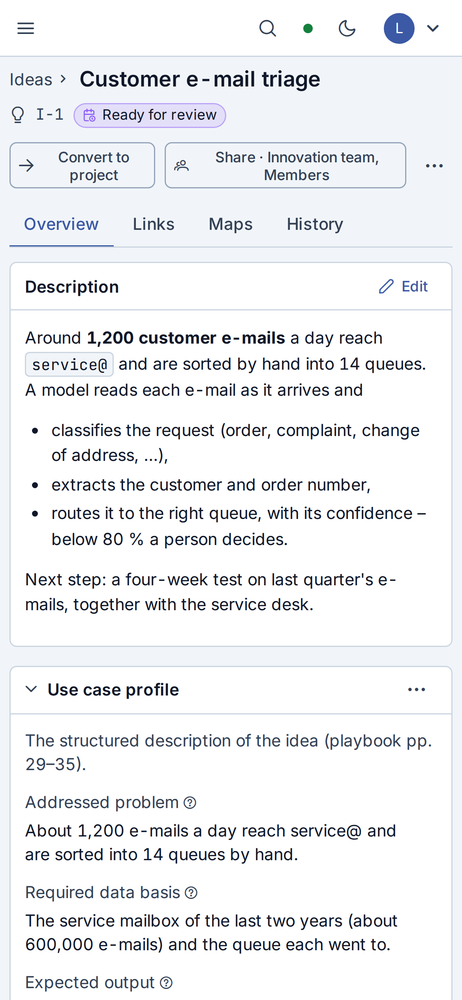
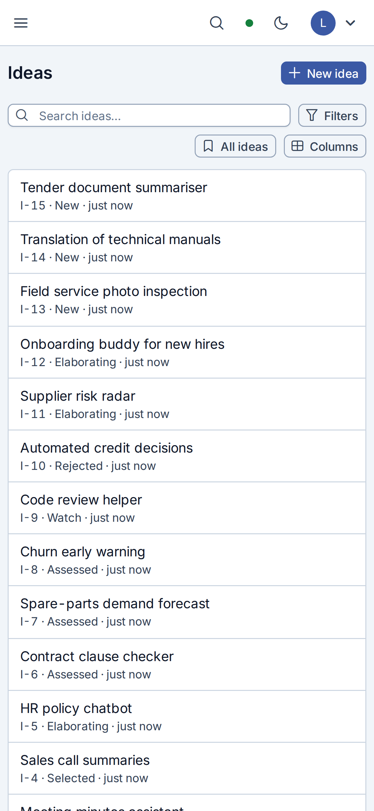
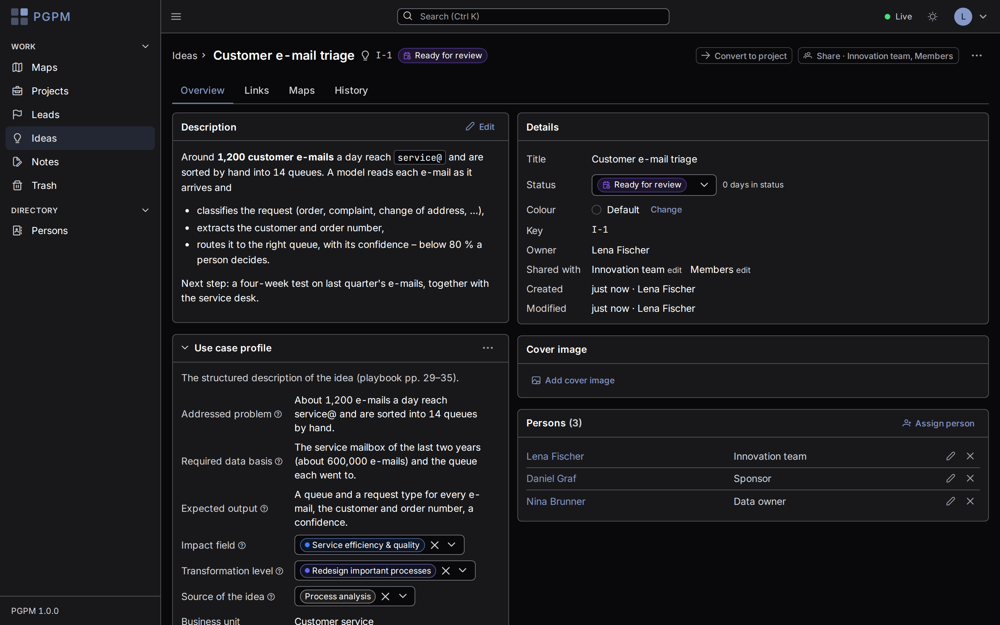

<p align="center">
  
</p>

<h1 align="center">PGPM</h1>

<p align="center">
  <b>Philipp's Global Project Manager</b><br>
  From a raw idea to a running use case – on maps, shared with your teams, live and offline.
</p>

<p align="center">
  
  
  
  
  
  
</p>

<p align="center">
  <a href="#screenshots">Screenshots</a> ·
  <a href="#features">Features</a> ·
  <a href="#quick-start-development">Quick start</a> ·
  <a href="docs/user-guide.md">User guide</a> ·
  <a href="docs/admin-guide.md">Admin guide</a> ·
  <a href="deploy/README.md">Deployment</a>
</p>

<p align="center">
  
  <br>
  <sub>A workshop board: every idea card sits in the column of its status and shows its impact score and feasibility index.</sub>
</p>

PGPM is an offline-first web app (PWA) for innovation work. It takes an idea through assessment, prioritization,
prototype and MVP to operation. Notes, ideas, leads and projects are laid out on **maps**, shared with **groups**, and
synced **live** between everyone connected. Everything a user may see also works offline. The innovation method of the
digitalswitzerland AI playbook comes built in. One-page overview: [docs/00-summary.md](docs/00-summary.md).

## Screenshots

<table>
  <tr>
    <td width="50%" valign="top">
      
      <p><b>Prioritization matrix.</b> Items place themselves by two scores. Card size follows the business value;
      ideas without a score wait in the tray.</p>
    </td>
    <td width="50%" valign="top">
      
      <p><b>An idea.</b> A Markdown description, the structured use-case profile, sharing, and persons with
      their roles. Every value can be edited in place.</p>
    </td>
  </tr>
  <tr>
    <td width="50%" valign="top">
      
      <p><b>Lists.</b> Search, filters, sort, bulk actions and saved views. Any field or score can be a
      column.</p>
    </td>
    <td width="50%" valign="top">
      
      <p><b>Projects with gates.</b> A template sets the milestones and gates, each with a Definition of Done and
      a go / no-go / iterate / pivot / park decision that moves the project on.</p>
    </td>
  </tr>
  <tr>
    <td width="50%" valign="top">
      
      <p><b>The playbook's assessment.</b> Twelve statements in four areas, each rated with one click, give the
      feasibility index live.</p>
    </td>
    <td width="50%" valign="top" align="center">
      
      &nbsp;
      
      <p align="left"><b>On the phone.</b> The same app, installed to the home screen. It works offline and
      syncs when the network is back.</p>
    </td>
  </tr>
</table>

<p align="center">
  
  <br>
  <sub>Light and dark theme, following the system or chosen in the app.</sub>
</p>

<sub>The screenshots show demo data and are taken by a script: `tools/screenshots.sh`
([PGPM.WebUI/e2e/screenshots.spec.ts](PGPM.WebUI/e2e/screenshots.spec.ts)).</sub>

## Features

- **Items:** notes, ideas, leads and projects. Each has:
  - a key (`I-42`) and a configurable status with overdue markers;
  - an owner, sharing, and assigned persons with roles;
  - attachments and a cover image;
  - typed links, history, and trash with full restore.
- **Lists:** search, filters, sort, columns, bulk actions and saved views (personal and shared). Detail pages edit
  inline. The Markdown editor has a visual and a source mode, and handles pasted images, Mermaid diagrams and item links.
- **Configuration:** sections and fields per item type. Field types:
  - text, number, date, select, person, URL;
  - rating 0–5;
  - computed scores.

  Sections can be restricted to groups. Project templates add milestones and **gates** with a Definition of Done
  and a go / no-go / iterate / pivot / park decision. Everything ships as importable **configuration packages**.
- **Maps:**
  - an infinite canvas: item cards, shapes, connected lines, text, images, milestones and timelines, with layers,
    snap, a minimap, undo and live co-editing;
  - **matrix maps**, which place items by two scores;
  - map templates for workshops.
- **Innovation method:** the digitalswitzerland AI playbook comes as a built-in package
  ([doc 04](docs/04-innovation-methodology.md)):
  - ambition and idea funnel;
  - assessment with a feasibility index;
  - prioritization matrix and review board;
  - AI use-case projects with gates G0–G3.
- **Access:**
  - local accounts with TOTP, and Microsoft Entra SSO (app roles → groups);
  - a persons directory synced from Entra;
  - rights as capabilities;
  - sharing per item and map at *read*, *edit* or *manage*.
- **Offline and sync:** an installable PWA with a local IndexedDB copy and a live WebSocket feed (< 1 s) that falls
  back to polling. Offline changes are queued, and the user resolves field conflicts.
- **MCP server** for AI assistants: personal read and write tokens, capped rights, every call logged.

## Architecture

```
 Browser (PWA)                                     Server (one container)                   Host
┌─────────────────────────────────┐   HTTPS   ┌───────────────────────────────────┐
│ Vue 3 + PrimeVue UI             │  ───────▶ │ ASP.NET Core (.NET 10)            │
│ Service worker (Workbox):       │  /api/v1  │  REST API · auth (cookie, TOTP,   │   ┌──────────────┐
│   app shell offline             │           │  Entra OIDC) · rights · sharing   │──▶│ PostgreSQL 18│
│ Dexie (IndexedDB): all data the │  /api/v1/ │  Sync: SyncWriter · pull pages ·  │   └──────────────┘
│   user may see, outbox, blobs   │ sync/live │  evictions · live hub (WebSocket) │   ┌──────────────┐
│ Sync engine: push/pull, live    │ ◀═══════▶ │  Files (chunked uploads)          │──▶│ files/ folder│
│   channel, conflicts            │   WS      │  Config packages · Maps · Persons │   └──────────────┘
└─────────────────────────────────┘           │  MCP server (/mcp, bearer tokens) │   ┌──────────────┐
 AI assistant ── Streamable HTTP ───────────▶ │  Background tasks (directory sync,│──▶│ key ring     │
                                              │  pruners, file checks)            │   └──────────────┘
                                              └──────────────┬────────────────────┘
                                                             │ Microsoft Graph (directory), Entra ID (SSO)
```

Every write goes through one `SyncWriter`, whether it comes from the browser, MCP, the directory sync or a package
import. That gives every write the same validation and access checks, a global change sequence, the change log, and a
live push to every device that may see the row. Details: [docs/03-implementation-reference.md](docs/03-implementation-reference.md).

## Quick start (development)

Needs Podman (or Docker with `ENGINE=docker`), the .NET 10 SDK and Python 3 for the tests. Node never runs on the host.

```sh
./start.sh            # builds the image, starts PostgreSQL and PGPM: http://localhost:7330/
WEB=dev ./start.sh    # …plus Vite with hot reload: http://localhost:5173/
./stop.sh             # stops everything (./stop.sh --data also offers to delete the data)
```

The first run writes `dev.env` (gitignored) with a generated database password and first-admin password, and prints
the sign-in.

## Development workflow

- **npm** runs only in a container:
  - `tools/npm.sh install --save-exact <pkg>@<version>`;
  - `tools/npm.sh run lint`;
  - `tools/npm.sh test`;
  - `tools/npm.sh run gen:api` (TypeScript types from `PGPM.WebUI/src/api/openapi.json`).
- **.NET:**
  - `dotnet build PGPM.slnx`. Warnings are errors. The Debug build rewrites `openapi.json`: commit it with API
    changes.
  - Migrations: `dotnet ef migrations add <Name> --project PGPM/PGPM.csproj`.
  - Lock files are committed, and the image restores in locked mode.
- **Tests:** `./run-tests.sh` runs every group, `--only` some of them, and `--list` shows them:

  | Group | What |
  |---|---|
  | `dotnet` | locked restore, build, no pending model change, PGPM.Tests on a throwaway PostgreSQL (`tools/test-db.sh`) in two time zones |
  | `web` | npm package check and signatures, API types, vue-tsc, ESLint, Prettier, Vitest, the build – in a node container |
  | `contract` | PGPM.Contract.Tests against the image (`tools/contract.sh`, port 7332) |
  | `e2e` | Playwright against the image, incl. offline and two-browser sync (`tools/e2e.sh`, port 7331) |
  | `deploy` | the `deploy/` scripts for real: init, up, users, a note and a file, backup, restore, update (`tools/deploy-test.sh`, port 7390) |
  | `shell` | `bash -n`, shellcheck, the configuration packages (`tools/check-packages.py`) |

- **Screenshots:** `tools/screenshots.sh` takes the pictures above on a stack of its own and saves them to
  `docs/images`.
- **CI:**
  - `.github/workflows/ci.yml` runs the same groups on GitHub's runners (`deploy` nightly and before a release);
  - `release.yml` publishes the image for a version tag `v<Version>`. The secrets it needs are documented in the file.

```
PGPM/                 ASP.NET Core host (feature folders: Auth, Sync, Items, Maps, Files, Mcp, Packages, …)
PGPM.Lib/             password hashing, TOTP, helpers
PGPM.WebUI/           Vue app incl. service worker
PGPM.Tests/           MSTest + WebApplicationFactory     PGPM.Contract.Tests/  against a running container
deploy/               production compose stack and scripts    tools/  dev and test scripts
spec/                 package schema, shared test vectors      docs/   specification and guides
```

## Configuration, deployment, MCP

- **Deployment:** [deploy/README.md](deploy/README.md) covers `./init.sh`, `docker compose up -d`, backups, restore,
  updates and the reverse proxy (Caddy, nginx).
- **Administration:** [docs/admin-guide.md](docs/admin-guide.md) covers the configuration keys, the Microsoft Entra
  registration, users and rights, packages, monitoring and troubleshooting.
- **MCP:** the server is at `<PublicUrl>/mcp`. Personal tokens are under *Security → MCP tokens*. Client examples:
  [docs/admin-guide.md §10](docs/admin-guide.md#10-mcp-for-ai-assistants).
- **Using it:** [docs/user-guide.md](docs/user-guide.md). What's in 1.0:
  [docs/release-notes-1.0.md](docs/release-notes-1.0.md).

## Documentation

| | |
|---|---|
| **Concept** | [00 Summary](docs/00-summary.md) · [01 Functional overview](docs/01-functional-overview.md) · [02 Data model](docs/02-data-model.md) · [04 Innovation method](docs/04-innovation-methodology.md) |
| **Build** | [03 Implementation reference](docs/03-implementation-reference.md) · [05 Build plan](docs/05-build-plan.md) · [06 Security review](docs/06-security-review.md) · [07 Performance](docs/07-performance.md) · [08 Field comments (plan)](docs/08-field-comments.md) |
| **Guides** | [User guide](docs/user-guide.md) · [Admin guide](docs/admin-guide.md) · [Deployment](deploy/README.md) · [Release notes 1.0](docs/release-notes-1.0.md) |

## Licence

Not decided yet: no licence is granted until one is added here.
