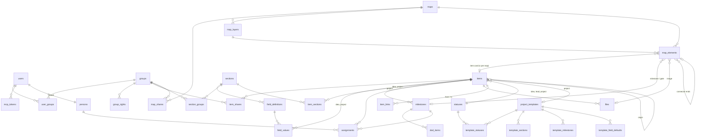

# PGPM – Data Model

> Status: v0.2 (2026-11-26) – object sharing, generic statuses, sections for
> ideas, rating/score fields, gates, item links, matrix maps, map templates,
> saved views, trash, evictions, user-resolved conflicts
> Related: [01-functional-overview.md](01-functional-overview.md) · [03-implementation-reference.md](03-implementation-reference.md) · [04-innovation-methodology.md](04-innovation-methodology.md) · [05-build-plan.md](05-build-plan.md)

## 1. Conventions

| Topic | Rule |
|---|---|
| Database | PostgreSQL 18, EF Core 10 (Npgsql), `EFCore.NamingConventions` → **snake_case** tables and columns. |
| Primary keys | `uuid`, **UUID v7**. For synced tables the id is **generated on the client** (offline creation), validated by the server (must be v7, must not exist). |
| Timestamps | `timestamptz`, UTC, written by the server. Client times (`client_changed_at`) are informational. |
| Text | Markdown for rich text (`description`). |
| Colors | `text`, `#rrggbb`. |
| Deletes | Synced rows are **soft-deleted** (`deleted = true`, tombstone). Rows deleted together share a `delete_batch_id`; batches of items and maps are restorable from the Trash until an admin purges them (§11.3). Other tombstones are pruned after 90 days. Config tables use `is_archived`. |
| JSON | `jsonb` only for schemaless parts (field values, element style, matrix and score configs, view definitions). Everything filtered or joined server-side is a column. |
| Enum-like values | lower-case `text` with a `CHECK` constraint. |

### 1.1 Synced-row columns

Every table marked **[S]** (synced to the PWA) carries:

| Column | Type | Meaning |
|---|---|---|
| `seq` | `bigint` not null, unique | Global change sequence number from `sync_counter` (§11.1), assigned on every insert/update/delete/re-stamp. Pull cursor. |
| `rev` | `int` not null | Row revision, starts at 1, +1 on every accepted change (not on re-stamp). |
| `deleted` | `bool` not null default false | Tombstone flag. |
| `delete_batch_id` | `uuid` null → `delete_batches` | Set on delete; rows deleted in one operation share it (restore unit). |
| `created_at`, `created_by` | `timestamptz`, `uuid` → users | |
| `updated_at`, `updated_by` | `timestamptz`, `uuid` → users | |

Implemented once as `ISyncedEntity` plus an EF Core `SaveChangesInterceptor`
(`SyncStampInterceptor`) that assigns `seq`/`rev`/`updated_*` for **every**
write – sync pushes, MCP tools, admin endpoints, restore, directory job – so no
code path can change a synced row without clients seeing it.

**[S, ro]** = synced, but read-only for clients (written via online admin/REST
endpoints only). Tables without a mark are server-only.

### 1.2 Per-user computed columns

Some rows are delivered with a value computed for the receiving user. They are
not stored:

| Table | Computed column | Values |
|---|---|---|
| `items` | `access` | `read` \| `edit` \| `manage` |
| `maps` | `access` | `read` \| `edit` \| `manage` |
| `sections` | `can_edit` | bool |

When the underlying shares change, the affected rows are **re-stamped** (new
`seq`, same `rev`) so every client receives them again (§11.5).

## 2. Overview (ER)



## 3. Identity

Identity tables are server-only except `groups` (names, for the share picker)
and the user ↔ person link (via `persons.user_id`). The client receives the
current user from `GET /api/v1/auth/me`. Phase 1 creates `users`, `groups`, `user_groups`, `group_rights`,
`persons` and `audit_log` without the synced-row columns; phase 2 adds them to `groups` and `persons`
(`ISyncedEntity`).

### `users` (PNMTD `UserEntity` + GGITSV Microsoft link)

| Column | Type | Notes |
|---|---|---|
| `id` | uuid PK | |
| `username` | text | login name; for SSO-provisioned users `preferred_username` |
| `normalized_username` | text | lower-case, **unique** |
| `display_name` | text | |
| `email` | text null | |
| `password_hash` | text null | `pbkdf2-sha256$210000$<salt>$<key>`; null = SSO-only account |
| `is_admin` | bool | sees and manages everything |
| `is_active` | bool | inactive → sessions, live connections and MCP tokens end |
| `must_change_password` | bool | |
| `temporary_password_expires_at` | timestamptz null | 7 days for new users / resets |
| `security_stamp` | text | rotated on password, 2FA, admin flag, active flag change → ends all sessions and MCP tokens |
| `totp_secret_protected` | text null | Data-Protection encrypted (`PGPM.Totp.v1`) |
| `is_totp_enabled` | bool | |
| `totp_last_used_step` | bigint null | replay protection |
| `pending_totp_secret_protected`, `pending_totp_created_at` | | setup in progress |
| `failed_login_count`, `lockout_count` | int | |
| `lockout_end` | timestamptz null | |
| `created_at`, `last_login_at`, `last_seen_at`, `password_changed_at` | timestamptz | `last_seen_at` = last UI/sync request, written at most every 5 min |
| `microsoft_tenant_id` | uuid null | Entra `tid` |
| `microsoft_object_id` | uuid null | Entra `oid`; **unique (`microsoft_tenant_id`, `microsoft_object_id`)** – the only key SSO logins are matched by |
| `microsoft_user_name` | text null | UPN from Graph `/me` |
| `directory_read_at` | timestamptz null | last Graph `/me` read at sign-in |
| `access_epoch` | int not null default 1 | incremented on structural access changes → the user's clients reset (§11.5) |

Every user has exactly one person (`persons.user_id`): linked to the directory
person for Microsoft users, otherwise a manual person created with the user.

### `groups` (PNMTD + GGITSV) [S, ro]

| Column | Type | Notes |
|---|---|---|
| `id` | uuid PK | |
| `name` | text | delivered to clients |
| `normalized_name` | text | unique |
| `description` | text null | max 500; delivered to clients |
| `entra_app_role` | text null | membership managed by this Entra app role (set at every SSO sign-in); unique where set, upper-cased; **not delivered** |
| + synced-row columns | | |

### `user_groups` (PNMTD)

PK (`user_id`, `group_id`), cascade on delete. Rows of groups with
`entra_app_role` cannot be edited manually (409 `membership_managed_by_entra`).
The current user's group ids are part of `/auth/me`.

### `group_rights` (PNMTD)

| Column | Type | Notes |
|---|---|---|
| `group_id` | uuid → groups | PK part, cascade |
| `area` | text | PK part; catalogue in doc 03 §6.2; lower-case with a CHECK (`notes`, …, `auditlog`, `system`) |
| `level` | text | ordered per area; higher includes lower; `create` \| `edit` \| `use` \| `view` \| `manage` (CHECK) |

Rights are capabilities (create, configure, administer). **Visibility is decided
by shares** (§4).

### `mcp_tokens` (PNMTD)

At most two rows per user – one `read`, one `write` token.

| Column | Type | Notes |
|---|---|---|
| `id` | uuid PK | |
| `user_id` | uuid → users | cascade; unique (`user_id`, `kind`) |
| `kind` | text | `read` \| `write` |
| `hash` | text | SHA-256 lower-hex of the token value, **unique**; the value is never stored |
| `hint` | text | last 4 characters |
| `issued_at` | timestamptz | |
| `on_since`, `on_until` | timestamptz null | |
| `on_stamp` | text | user's `security_stamp` when switched on; mismatch → off |
| `delete_until`, `delete_count` | | delete window (reserved, no delete tools in v1) |
| `last_used_at`, `last_used_from`, `last_client` | | |
| `strikes` | timestamptz[] | refused calls; 3 within 24 h → blocked |
| `blocked_at`, `ended_at` | timestamptz null | |
| `ended_why` | text null | `off` \| `expired` \| `regenerated` \| `stamp` \| `strikes` \| `admin` \| `user_inactive` \| `totp_off` |
| `ended_note` | text null | |

### `mcp_log` (PNMTD)

One row per MCP call: `id`, `at`, `token_id`, `user_id`, `tool`, `arguments`
(jsonb, redacted), `result` (bytea, gzipped), `outcome` (`ok` \| `error` \|
`denied` \| `rate_limited`), `correlation_id`, `duration_ms`. Newest 10,000
kept.

### `key_values` (PNMTD)

`key text PK`, `value text`, `updated_at` – task health and small system
settings.

## 4. Access (sharing)

### 4.1 Rules

Effective access of a user to an **item** or **map**:

```
access = manage                       if user.is_admin
       = manage                       if owner_user_id = user.id
       = max(share.access)            over shares whose group_id ∈ user's groups
       = none                         otherwise
```

Order: `read` < `edit` < `manage`. Everything below an item (field values,
item sections, milestones, DoD items, assignments, files, outgoing links, shares)
inherits the item's access; everything on a map inherits the map's access.
Section restrictions (§7.3) narrow field visibility/editability further.

### `item_shares` [S, ro after creation]

| Column | Type | Notes |
|---|---|---|
| `id` | uuid PK | |
| `item_id` | uuid → items | |
| `group_id` | uuid → groups | |
| `access` | text | `read` \| `edit` \| `manage` |
| + synced-row columns | | |

Unique (`item_id`, `group_id`) where not deleted. Index (`group_id`, `item_id`).
Clients may **insert** shares together with a new item (offline-capable create
dialog, same outbox batch). Later changes go through the online endpoint
`PUT /api/v1/items/{id}/shares` (needs *manage*).

### `map_shares` [S, ro after creation]

Same columns with `map_id` instead of `item_id`.

## 5. Persons directory

### `persons` [S]

| Column | Type | Notes |
|---|---|---|
| `id` | uuid PK | |
| `source` | text | `microsoft` \| `manual` |
| `entra_tenant_id`, `entra_object_id` | uuid null | set for `microsoft`; **unique pair** where not null |
| `display_name` | text not null | "fullname" |
| `given_name`, `surname` | text null | |
| `email` | text null | lower-cased; index (not unique) |
| `user_principal_name` | text null | |
| `user_type` | text null | `Member` \| `Guest` |
| `job_title`, `department`, `company_name` | text null | |
| `phone`, `mobile_phone` | text null | |
| `is_active` | bool | `false` when disabled or removed from the directory |
| `directory_synced_at` | timestamptz null | |
| `notes` | text null | editable by *Persons: Edit* |
| `user_id` | uuid null → users | unique where not null; set null when the user is deleted |
| + synced-row columns | | (phase 2) |

All users receive all persons. Directory fields of `microsoft` persons are
written only by the directory job; patches on them are rejected.

### `directory_sync_state`

One row per tenant: `tenant_id` PK, `delta_link`, `last_started_at`,
`last_finished_at`, `last_status` (`ok` \| `failed` \| `running`), `last_error`,
`created_count`, `updated_count`, `deactivated_count`.

## 6. Items

### `items` [S] – notes, ideas, leads, projects (EF Core TPH, discriminator `type`)

| Column | Type | Types | Notes |
|---|---|---|---|
| `id` | uuid PK | all | |
| `type` | text | all | `note` \| `idea` \| `lead` \| `project`; immutable |
| `number` | int null | all | per-type running number assigned by the server on first insert |
| `title` | text not null | all | 1–300 chars |
| `description` | text null | all | Markdown |
| `color` | text null | all | null → type default color |
| `image_file_id` | uuid null → files | all | cover image |
| `owner_user_id` | uuid → users | all | creator; transferable (online, *manage*) |
| `status_id` | uuid null → statuses | idea, lead, project | required for these types (`CHECK`); `statuses.item_type` must match |
| `status_changed_at` | timestamptz null | idea, lead, project | set by the server on status change → aging (§7.1) |
| `tags` | text[] default `{}` | all | later |
| `origin_item_id` | uuid null → items | project | converted from |
| `converted_to_item_id` | uuid null → items | idea, lead | |
| `pinned` | bool default false | note | |
| `lead_organisation` | text null | lead | |
| `lead_value` | numeric(14,2) null | lead | |
| `lead_currency` | text null | lead | ISO 4217, default CHF |
| `lead_probability` | smallint null | lead | 0–100 |
| `lead_decision_date` | date null | lead | |
| `lead_next_action` | text null | lead | |
| `lead_next_action_due` | date null | lead | |
| `lead_source` | text null | lead | |
| `project_template_id` | uuid null → project_templates | project | |
| `project_start_date`, `project_end_date` | date null | project | |
| + synced-row columns | | | |
| *`access`* | computed | all | §1.2 |

Display key `<prefix>-<number>` with `N`, `I`, `L`, `P`; numbers from
`number_counters (type text PK, next_value int)`, incremented in the push
transaction. Indexes: (`type`, `deleted`), `status_id`, `owner_user_id`,
`GIN(tags)`, trigram on `title`.

### `assignments` [S]

| Column | Type | Notes |
|---|---|---|
| `id` | uuid PK | |
| `item_id` | uuid null → items | exactly one of `item_id`/`milestone_id` (`CHECK`) |
| `milestone_id` | uuid null → milestones | |
| `person_id` | uuid → persons | |
| `role` | text null | free text with suggestions |
| `sort_order` | text | fractional index (§10) |
| + synced-row columns | | |

Unique (`item_id`, `person_id`) and (`milestone_id`, `person_id`) where not
deleted – a duplicate insert is merged automatically (doc 03 §11.5).

### `item_links` [S]

| Column | Type | Notes |
|---|---|---|
| `id` | uuid PK | |
| `from_item_id` | uuid → items | the link belongs to the source item (access, delete cascade) |
| `to_item_id` | uuid → items | target; shown *restricted* if not readable |
| `relation` | text | `contributes_to` \| `learning_of` \| `depends_on` \| `related` |
| + synced-row columns | | |

Unique (`from_item_id`, `to_item_id`, `relation`) where not deleted (duplicates
merged). Delivered to a user when the source item is readable; the client
resolves the target locally. Deleting the target item tombstones incoming links
in the same delete batch.

### `files` [S] (attachments, cover images, map images)

| Column | Type | Notes |
|---|---|---|
| `id` | uuid PK | client-generated |
| `item_id` | uuid null → items | owner item |
| `map_id` | uuid null → maps | owner map |
| `purpose` | text | `attachment` \| `cover` \| `map_image` \| `embedded` (image inserted into Markdown text; not listed among attachments) |
| `file_name` | text | editable (rename) |
| `content_type` | text | validated server-side |
| `size_bytes` | bigint | |
| `sha256` | text | hex, computed by the client, verified by the server |
| `width`, `height` | int null | images |
| `thumbnail` | bytea null | ≤ 32 KB WebP, generated client-side |
| `status` | text | `pending` \| `available` |
| `storage_path` | text null | server-only, `yyyy/MM/{id}-{slug}.{ext}`; never sent |
| + synced-row columns | | |

`CHECK (num_nonnulls(item_id, map_id) = 1)`; index on `sha256`.

Markdown text (descriptions, note content, milestone descriptions, `markdown`
fields) references files as `/api/v1/files/{id}/{name}` – images as
``, other files as links. `embedded` files no longer referenced by any
text of their item for 30 days are deleted by `FileCleanupTask` (the delay keeps
History restores working).

### `file_uploads` (server-only)

Chunked upload in progress: `file_id` PK, `user_id`, `received_bytes`,
`started_at`, `temp_path`. Removed on commit; stale after 24 h.

## 7. Configuration

All configuration tables are **[S, ro]**: edited online through admin endpoints
(*Configuration: Manage*), synced read-only to clients (needed offline for forms,
scores, filters, templates).

### 7.1 `statuses` [S, ro]

| Column | Type | Notes |
|---|---|---|
| `id` | uuid PK | |
| `item_type` | text | `idea` \| `lead` \| `project` |
| `name` | text | unique per `item_type` among non-archived |
| `color` | text | |
| `icon` | text null | PrimeIcons name |
| `category` | text | `open` \| `active` \| `closed` |
| `sort_order` | int | |
| `is_default` | bool | one per `item_type` (partial unique index) |
| `max_days` | int null | aging: *overdue* when `now − status_changed_at > max_days` |
| `is_archived` | bool | |
| + synced-row columns | | |

### 7.2 `sections` [S, ro]

| Column | Type | Notes |
|---|---|---|
| `id` | uuid PK | |
| `name` | text | |
| `description` | text null | |
| `applies_to` | text[] | ⊆ {`idea`, `project`}, not empty |
| `default_for` | text[] | ⊆ `applies_to`; added automatically to new items of that type (projects: only without template) |
| `sort_order` | int | |
| `collapsed_by_default` | bool | |
| `is_archived` | bool | |
| + synced-row columns | | |
| *`can_edit`* | computed | §1.2 |

Sections the user may not view are not delivered.

### 7.3 `section_groups` (server-only)

| Column | Type | Notes |
|---|---|---|
| `section_id` | uuid → sections | PK part |
| `group_id` | uuid → groups | PK part |
| `access` | text | `view` \| `edit` |

No `view`/`edit` rows → visible to everyone with access to the item; no `edit`
rows → editable by everyone with *edit* on the item. `edit` implies `view`.
Effective field access = min(item access, section access).

### 7.4 `field_definitions` [S, ro]

| Column | Type | Notes |
|---|---|---|
| `id` | uuid PK | |
| `section_id` | uuid → sections | |
| `key` | text | unique, `^[a-z][a-z0-9_]{1,62}$`, **immutable** |
| `label` | text | |
| `help_text` | text null | |
| `type` | text | `text` \| `textarea` \| `markdown` \| `number` \| `date` \| `datetime` \| `bool` \| `select` \| `multiselect` \| `person` \| `url` \| `email` \| `rating` \| `score` |
| `config` | jsonb | by type, see below |
| `required` | bool | UI-enforced; server validates on push |
| `default_value` | jsonb null | |
| `sort_order` | int | |
| `is_archived` | bool | |
| + synced-row columns | | |

`config` by type:

```jsonc
// text
{ "maxLength": 200, "placeholder": "…" }
// number
{ "decimals": 2, "min": 0, "max": null, "unit": "CHF" }
// date / datetime
{ "timebox": true }                       // overdue marker when passed and item not closed
// select / multiselect – option ids are stable, labels may change
{ "options": [ { "id": "lt3", "label": "< 3 months", "color": "#16a34a", "points": 5, "archived": false } ],
  "multiPoints": "count" }                // multiselect in scores: count | sum
// person
{ "multiple": true }
// rating
{ "min": 0, "max": 5, "allowNa": true, "labels": { "0": "not at all", "5": "fully" } }
// score – read-only, computed
{ "op": "sum",                            // sum | avg | product | count | min | max
  "inputs": ["feas_data_access", "feas_infra", "…", "time_to_proof_of_value"],
  "na": "rescale",                        // rescale | ignore | zero
  "max": 65,                              // display "58 / 65"; rescale target
  "cap": { "strategic_advantages": 5 },   // optional per-input cap
  "scale": 1,                             // multiply result (e.g. 0.01 for % × %)
  "normalize": false,                     // true → 0–100 using max
  "decimals": 0 }
```

Score evaluation is specified once and implemented identically in TypeScript
(client) and C# (MCP/server), with shared test vectors (doc 03 §16). Score
inputs must not form cycles (validated when saving configuration). Score values
are **never stored**.

### 7.5 `field_values` [S]

| Column | Type | Notes |
|---|---|---|
| `id` | uuid PK | |
| `item_id` | uuid → items | idea or project |
| `field_id` | uuid → field_definitions | not of type `score` |
| `value` | jsonb | see below |
| + synced-row columns | | |

Unique (`item_id`, `field_id`) where not deleted. Concurrent offline inserts of
the same pair are turned into a patch by the server (doc 03 §11.5).

| Field type | `value` |
|---|---|
| text, textarea, markdown, url, email | `"string"` (markdown: GFM, stored exactly as written) |
| number | `12.5` |
| date / datetime | `"2026-11-26"` / `"2026-11-26T14:00:00Z"` |
| bool | `true` |
| select | `"lt3"` (option id) |
| multiselect | `["o1","o3"]` |
| person | `["<person uuid>", …]` |
| rating | `4` or `"na"` |

### 7.6 `item_sections` [S]

Which catalogue sections an idea or project shows.

| Column | Type | Notes |
|---|---|---|
| `id` | uuid PK | |
| `item_id` | uuid → items | |
| `section_id` | uuid → sections | must apply to the item's type |
| `sort_order` | int | |
| + synced-row columns | | |

Unique (`item_id`, `section_id`) where not deleted (duplicates merged).
Removing a section tombstones the row; `field_values` stay.

### 7.7 Project templates

### `project_templates` [S, ro]

| Column | Type | Notes |
|---|---|---|
| `id` | uuid PK | |
| `name` | text | |
| `description` | text null | |
| `color`, `icon` | text null | |
| `default_status_id` | uuid null → statuses | must be allowed |
| `default_shares` | jsonb | `[{"groupId": "…", "access": "edit"}]` – preselected in the create dialog |
| `sort_order` | int | |
| `is_archived` | bool | |
| + synced-row columns | | |

### `template_statuses` [S, ro]

`id`, `template_id`, `status_id` (project statuses), synced-row columns. None →
all project statuses allowed.

### `template_sections` [S, ro]

`id`, `template_id`, `section_id` (must apply to projects), `sort_order`,
synced-row columns.

### `template_field_defaults` [S, ro]

`id`, `template_id`, `field_id`, `value` jsonb, synced-row columns.

### `template_milestones` [S, ro]

| Column | Type | Notes |
|---|---|---|
| `id` | uuid PK | |
| `template_id` | uuid → project_templates | |
| `kind` | text | `milestone` \| `gate` |
| `title` | text | |
| `description` | text null | |
| `offset_days` | int null | due = project start + offset |
| `dod` | jsonb | `["criterion 1", "criterion 2"]` |
| `on_go_status_id` | uuid null → statuses | gate: status suggested on *go* |
| `on_no_go_status_id` | uuid null → statuses | gate: status suggested on *no-go* |
| `sort_order` | int | |
| + synced-row columns | | |

Applying a template happens **on the client** (offline-capable): it inserts the
project, `item_shares`, `item_sections`, `field_values` (defaults), `milestones`
and `dod_items` in one outbox batch.

### 7.8 `saved_views` [S]

| Column | Type | Notes |
|---|---|---|
| `id` | uuid PK | |
| `owner_user_id` | uuid → users | |
| `item_type` | text | `note` \| `idea` \| `lead` \| `project` \| `gate` (gate-decision list) |
| `name` | text | |
| `definition` | jsonb | `{search, filters, sort, columns}` (same shape as `user_settings` list state) |
| `is_shared` | bool | visible to all users; only *Configuration: Manage* may set/edit shared views |
| `sort_order` | int | |
| + synced-row columns | | |

Delivered: own views + shared views.

### 7.9 `config_keys` (server-only)

Stable keys of configuration entities for configuration packages (doc 03 §17):
`entity` text, `key` text (e.g. `field:feasibility_index`), `id` uuid,
`package` text null; unique (`entity`, `key`). Re-importing a package updates the
entities with known keys instead of duplicating them.

## 8. Milestones and gates

### `milestones` [S]

| Column | Type | Notes |
|---|---|---|
| `id` | uuid PK | |
| `item_id` | uuid → items | project |
| `kind` | text | `milestone` \| `gate` |
| `title` | text | |
| `description` | text null | |
| `due_date` | date null | |
| `status` | text | `planned` \| `in_progress` \| `done` \| `cancelled` |
| `completed_at` | timestamptz null | |
| `decision` | text null | gates: `pending` \| `go` \| `no_go` \| `iterate` \| `pivot` \| `park` |
| `decision_note` | text null | |
| `decided_at` | timestamptz null | |
| `decided_by` | uuid null → users | |
| `on_go_status_id`, `on_no_go_status_id` | uuid null → statuses | copied from the template |
| `color` | text null | null → project color |
| `sort_order` | text | fractional index |
| + synced-row columns | | |

### `dod_items` [S]

| Column | Type | Notes |
|---|---|---|
| `id` | uuid PK | |
| `milestone_id` | uuid → milestones | |
| `text` | text | |
| `state` | text | `open` \| `done` \| `na` |
| `note` | text null | evidence (link or text); required when `na` |
| `state_changed_by` | uuid null → users | |
| `state_changed_at` | timestamptz null | |
| `sort_order` | text | fractional index |
| + synced-row columns | | |

## 9. Maps

### `maps` [S]

| Column | Type | Notes |
|---|---|---|
| `id` | uuid PK | |
| `kind` | text | `canvas` \| `matrix` |
| `name` | text | |
| `description` | text null | |
| `owner_user_id` | uuid → users | |
| `settings` | jsonb | `{ "background": "#f8fafc", "grid": true, "snap": false, "gridSize": 20, "cardBadges": ["feasibility_index"] }` |
| `matrix` | jsonb null | `kind = matrix`, see below |
| `default_view` | jsonb null | default visibility filter |
| `is_template` | bool | canvas templates (*Configuration: Manage*) |
| `template_source_id` | uuid null → maps | created from this template (informational) |
| `preview` | bytea null | small WebP thumbnail, rendered by the client |
| + synced-row columns | | |
| *`access`* | computed | §1.2 |

Map templates are delivered to every user (read access implied for *New map
from template*); their elements are copied on the client.

`matrix`:

```jsonc
{ "x": { "field": "feasibility_index", "label": "Ease of implementation", "min": 0, "max": 65,  "split": 32.5 },
  "y": { "field": "impact_score",      "label": "Business impact",        "min": 0, "max": 100, "split": 50 },
  "size": { "field": "business_value_chf" },
  "quadrants": { "tr": "Star initiatives", "br": "Quick wins", "tl": "Difficult but impactful", "bl": "Limited interest" },
  "filter": { "types": ["idea", "project"], "statusIds": [], "templateIds": [], "groupIds": [] } }
```

### `map_layers` [S]

| Column | Type | Notes |
|---|---|---|
| `id` | uuid PK | |
| `map_id` | uuid → maps | |
| `name` | text | |
| `sort_order` | text | fractional; higher = on top |
| `is_visible` | bool | shared default |
| `is_locked` | bool | |
| + synced-row columns | | |

Every map has at least one layer.

### `map_elements` [S]

| Column | Type | Notes |
|---|---|---|
| `id` | uuid PK | |
| `map_id` | uuid → maps | |
| `layer_id` | uuid → map_layers | |
| `kind` | text | `item` \| `milestone` \| `timeline` \| `rect` \| `ellipse` \| `line` \| `text` \| `image` |
| `z` | text | fractional index within the layer |
| `x`, `y` | double precision | finite, within ±1,000,000, rounded to 2 decimals |
| `width`, `height` | double precision | > 0 |
| `item_id` | uuid null → items | `kind = item`; **not unique** – any number of cards per item and map |
| `milestone_id` | uuid null → milestones | `kind = milestone` (milestone or gate) |
| `project_id` | uuid null → items | `kind = timeline` |
| `file_id` | uuid null → files | `kind = image` |
| `text` | text null | text elements, labels |
| `points` | jsonb null | `line`: `[[x1,y1],[x2,y2]]` relative to `x`,`y` |
| `start_element_id`, `end_element_id` | uuid null → map_elements | connected line ends |
| `style` | jsonb | see below |
| `config` | jsonb null | kind-specific |
| + synced-row columns | | |

On matrix maps, item cards are **computed** from `maps.matrix` and have no rows;
only free elements (text, shapes, lines, images) are stored.

`style` (all keys optional):

```jsonc
{ "fill": "#fde68a", "stroke": "#334155", "strokeWidth": 2, "strokeStyle": "solid",
  "opacity": 1, "radius": 8, "fontSize": 16, "bold": false, "italic": false,
  "textColor": "#0f172a", "align": "left", "arrowStart": "none", "arrowEnd": "arrow",
  "lineType": "straight" }
```

`config`:

```jsonc
// item
{ "size": "compact" }
// timeline
{ "orientation": "horizontal", "spacing": "even", "milestoneIds": null, "showDates": true, "showLabels": true }
```

Item color, image and status come from the item – identical on every card.

## 10. Fractional ordering

`z` (elements), `sort_order` of layers, milestones, DoD items and assignments use
**fractional index strings** (`fractional-indexing`: `a0`, `a0V`, `a1` …).
Reordering writes one row (front/back/forward/backward: the selected rows that
pass another one; `PGPM.WebUI/src/domain/fractional.ts`); ties are broken by
`id`. Keys and ids compare by code unit – never `localeCompare` (`"Zz" < "a0"`);
PostgreSQL orders them with `COLLATE "C"`. The server accepts the package's
default format only, at most 255 characters (`PGPM.Lib/Helper/FractionalKey.cs`).

## 11. Synchronization

### 11.1 `sync_counter` (server-only)

Single row `id = 1`, `value bigint`. Locked `FOR UPDATE` by every write
transaction that touches a synced table; incremented once per changed row.
Global (not per user) because data is shared.

### 11.2 `sync_mutations` (server-only)

Idempotency log: `mutation_id` PK, `user_id`, `client_id`, `result` jsonb (stored
answer, replayed on retry), `processed_at` (pruned after 30 days).

### 11.3 `delete_batches` (server-only)

| Column | Type | Notes |
|---|---|---|
| `id` | uuid PK | = `delete_batch_id` on the rows |
| `root_kind` | text | `item` \| `map` \| `other` |
| `root_id` | uuid null | the deleted item or map |
| `deleted_at`, `deleted_by` | | |
| `restored_at`, `restored_by` | null | set on restore |
| `purged_at`, `purged_by` | null | set on permanent delete |

- **Trash** = batches with `root_kind` `item`/`map`, not restored, not purged.
- **Restore** un-deletes all rows of the batch (new `seq`, `rev + 1`), skipping
  rows whose parent no longer exists (e.g. cards on a map that is itself deleted)
  and duplicates of unique pairs.
- **Purge** physically deletes the rows and files of the batch and raises
  `sync_state.tombstone_horizon_seq`.
- Tombstones of `other` batches (map element removals, unassignments, …) are
  pruned after `Sync:TombstoneDays` (90).

### 11.4 `sync_clients`, `sync_state`, `sync_evictions` (server-only)

- `sync_clients`: `id` (client-generated), `user_id`, `user_agent`,
  `app_version`, `last_seen_at`, `last_seq`, `pending_count`, `conflict_count`,
  `live_connected` (bool). Deleting a row makes that client reset.
- `sync_state`: single row, `tombstone_horizon_seq bigint`.
- `sync_evictions`: `id` bigint PK, `user_id`, `seq` (from `sync_counter`),
  `root_kind` (`item` \| `map`), `root_id`. Written when a user **loses** access
  to an item or map; delivered with the pull/live feed to that user only; the
  client deletes the root and everything below it. Pruned after 90 days (older
  cursors reset anyway).

### 11.5 Visibility in the pull and access changes

| Table | Delivered to a user when |
|---|---|
| `items` | access ≠ none (§4.1) |
| `item_shares`, `item_sections`, `milestones`, `dod_items`, `assignments` (item/milestone), `files` (item), `item_links` (from) | parent item readable |
| `field_values` | item readable **and** section visible (§7.3) |
| `maps`, `map_shares`, `map_layers`, `map_elements`, `files` (map) | map readable, or map is a template |
| `persons`, `groups`, configuration tables | always (`sections`: only if visible) |
| `saved_views` | own or shared |
| `user_settings` | own |

| Change | Handling |
|---|---|
| Share **added or raised** (item/map) | **re-stamp** the root and all rows below it → normal pull/live feed delivers them (with the new computed `access`) |
| Share **removed or lowered** | re-stamp (users keeping access get the new `access`); for users who **lost** access entirely: insert `sync_evictions` rows |
| Owner transferred | re-stamp; eviction for the old owner if no access remains |
| Group membership changed, admin flag changed, `section_groups` changed | `users.access_epoch += 1` for affected users → `reset` |
| Client cursor < `tombstone_horizon_seq` | `reset` |

Reset = the client pushes its outbox, wipes the synced stores and pulls from 0.

## 12. History and audit

### `change_log` (server-only, read through the API)

| Column | Type | Notes |
|---|---|---|
| `id` | bigint identity PK | |
| `at` | timestamptz | |
| `user_id` | uuid null | null for system jobs |
| `source` | text | `ui` \| `mcp` \| `admin` \| `directory` \| `restore` \| `system` |
| `entity`, `entity_id` | text, uuid | |
| `item_id` | uuid null | root item for the History tab |
| `map_id` | uuid null | |
| `action` | text | `create` \| `update` \| `delete` \| `restore` \| `share` \| `conflict` \| `conflict_resolved` |
| `changes` | jsonb | `[{"field":"title","old":"A","new":"B"}]`; `conflict`: `{"field","yours","theirs","by"}`; `conflict_resolved`: `{"field","resolution":"mine"|"theirs"|"edited"}` |
| `client_changed_at` | timestamptz null | |
| `correlation_id` | text | |

Indexes (`item_id`, `at desc`), (`map_id`, `at desc`), (`entity`, `entity_id`).
Map element moves are logged compactly and pruned after 90 days.

### `audit_log` (server-only, PNMTD)

Security and administration events: sign-in, SSO provisioning, Microsoft
account linked/unlinked, membership (source `entra`/`ui`), rights, users,
MCP tokens, configuration changes, sharing changes, restore/purge, denied
requests. Columns: `id` (uuid v7), `at`, `event` (dotted lower case: `auth.login_failed`, `user.provisioned`),
`actor` (`user` \| `mcp` \| `system` \| `entra`; the CLI and the seeds are `system` with `actor_ref` `cli` /
`seed`), `actor_user_id`, `actor_ref`, `subject_type` (`user` \| `group` \| `person`, …), `subject_id`, `detail`
jsonb, `ip`, `correlation_id`. No foreign keys: an entry outlives its user. `detail` holds what PNMTD has columns
for: `{username, subjectName, summary, outcome: succeeded|failed|denied, error ("409 last_admin"), request
("PUT /api/v1/users/{id:guid}"), userAgent, changes: [{object, field, old, new, kind, summary}], changesLeftOut}` –
secrets only as `kind: "secret"`, never a value. Indexes (`at`), (`subject_id`, `at`), (`actor_user_id`, `at`),
(`event`).

## 13. User settings

### `user_settings` [S] (own rows only)

`id`, `user_id`, `key`, `value` jsonb, synced-row columns; unique (`user_id`,
`key`).

```jsonc
// list:<type> – last used list state
{ "viewId": null, "search": "", "filters": { "statusIds": ["…"] }, "sort": ["-updated_at"],
  "columns": ["key","title","status","field:feasibility_index"] }
// map:<id> – personal map view
{ "types": ["note","idea","lead","project","milestone","drawing"], "statusIds": null,
  "personIds": null, "quadrants": null, "hiddenLayerIds": [], "showLinks": false,
  "viewport": { "x": 0, "y": 0, "k": 1 } }
```

Device-local UI state (theme, sidebar, column widths, Markdown editor modes
`{page, field}`) stays in `localStorage` (PNMTD `stores/preferences.ts`).

## 14. Client database (IndexedDB, Dexie)

Database `pgpm`, additive versioned migrations.

| Store | Key | Indexes | Content |
|---|---|---|---|
| one store per synced table | `id` | parent ids (`item_id`, `map_id`, `milestone_id`, `from_item_id`, `to_item_id`, `section_id`), `type`, `status_id` | server row **with pending outbox changes applied** |
| `outbox` | `seq` autoIncrement | `table+id`, `batch` | pending mutations (§14.1) |
| `conflicts` | `id` | `table+id`, `map_id` | held-back changes awaiting a decision (§14.2) |
| `blobs` | file `id` | `cached_at` | file bytes (cover/map images eager, attachments on demand; 200 MB budget) |
| `drafts` | key | | unsaved description/create-dialog state |
| `meta` | key | | `cursor`, `accessEpoch`, `clientId`, `lastSyncAt`, `userId` (whose data it is), `resolved` (decisions not reported yet); the cached `/auth/me` stays in localStorage (read synchronously at start) |

### 14.1 Outbox entry

```jsonc
{
  "mutationId": "0193…",          // uuid v7
  "batch": "0193…",               // entries that belong together (create dialog, template)
  "table": "items",
  "id": "0193…",
  "op": "patch",                  // insert | patch | delete
  "baseRev": 4,
  "changes": {                    // patch: changed fields with the value the user saw
    "title":      { "old": "Website", "new": "Website relaunch" },
    "style.fill": { "old": "#fff",    "new": "#fde68a" }
  },
  "row": null,                    // insert: complete row
  "clientChangedAt": "2026-11-26T09:12:00Z"
}
```

Locally the entry also carries `seq` (the store key) and `sentAt` (set when a push takes it; a sent
entry is never coalesced again); neither is pushed. A stored row keeps its bookkeeping in
`_local: {serverRev, pending, base}` (docs/03 §11.7).

Consecutive patches of the same row are coalesced (first `old`, last `new`);
insert + delete of a never-synced row cancel out. In detail
(`PGPM.WebUI/src/local/outbox.ts`, `coalesce`, for entries not sent yet – a
merged entry keeps the first one's `mutationId`, `seq`, `batch` and `baseRev`):

- patch + patch → one patch; a key changed back to its original value (JSON
  equality) disappears, a patch without keys too. A key and a member of it
  (`style` and `style.fill`) are not merged.
- insert + patches → the insert with the patches applied to its row.
- patch(es) + delete → the delete with the first patch's `baseRev`.
- insert + delete → both dropped (with the patches between), unless another
  pending entry refers to the row (e.g. a field value's `item_id`).
- A later patch is not merged into an earlier entry when an insert between them
  is a row it refers to (a reference never arrives before its row).
- `baseRev` is `null` for inserts. Patch keys are columns or dotted members of
  jsonb columns; `applyPatch` creates missing objects, `undefined` removes a
  member; `rebase` re-applies pending patches on a fresh server row (a pending
  delete marks it `deleted`, a tombstone stays a tombstone).

### 14.2 Conflict entry

```jsonc
{
  "id": "0193…",
  "table": "items", "rowId": "0193…", "mapId": null,
  "kind": "field",                // field | deleted_by_other | changed_since_delete
  "fields": {
    "title": { "mine": "Website relaunch", "theirs": "Website 2027",
               "by": "Anna Muster", "at": "2026-11-26T09:10:12Z" }
  },
  "baseRev": 5,                   // server rev when the conflict was reported
  "createdAt": "2026-11-26T09:12:03Z"
}
```

*Keep mine* creates a new patch with `old = theirs`, `new = mine`; *Keep theirs*
drops the entry; *Edit* creates a patch with the edited value.
