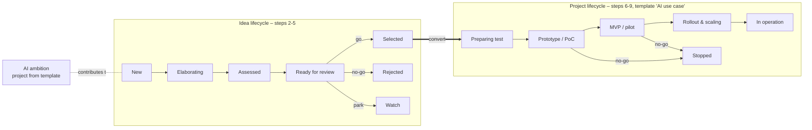

# PGPM – Innovation Methodology: Recommendation

> Status: v0.2 (2026-11-26) – **R1–R8 accepted** and merged into docs 01–03 v0.2;
> R9 (F9–F11) planned for later. Open questions of §7 resolved.
> Source: digitalswitzerland / Implement Consulting Group, *KI – konkret, erfolgreich,
> pragmatisch. Das Handbuch*, 1st edition 2026 ([extdocs/Digital-Switzerland-AI-Playbook.pdf](../extdocs/Digital-Switzerland-AI-Playbook.pdf)),
> cited as "playbook, p. N".
> Related: [01-functional-overview.md](01-functional-overview.md) · [02-data-model.md](02-data-model.md) · [03-implementation-reference.md](03-implementation-reference.md)

PGPM will be used to track innovation projects of the kind the playbook
describes. This document lists what PGPM should take over from the playbook in
**methodology, concepts, structure and checklists**, and how. Original German
terms are given in parentheses so they can be found in the playbook.

---

## 0. Summary

The playbook's core is a **use-case funnel**: set an *AI ambition* → collect
many ideas → assess each with a fixed template (value + feasibility + risk
flags) → place them in a **prioritization matrix** → take 2–3 core ideas through
**prototype → MVP → rollout**, with a go/no-go decision after each stage and a
checklist per stage (playbook, pp. 27–41).

About 70 % of this can be built with what PGPM already has: configurable
statuses, sections and fields, project templates, milestones with a Definition
of Done, person roles, group-restricted sections and maps. The rest needs a few
**generic** features that also help non-AI projects.

| # | Recommendation | Type | Priority |
|---|---|---|---|
| R1 | Model the funnel as **lifecycles**: idea statuses for identify/assess/prioritize, project statuses for test/rollout, idea → project conversion = review-board "go" | configuration + F1 | **Must** |
| R2 | Ship an **"AI use case" package**: sections and fields from the assessment template, project template with stage gates whose DoD are the playbook checklists | seed content | **Must** |
| R3 | **Sections, fields and statuses for ideas** (not only projects), and status sets per template | feature F1 | **Must** |
| R4 | **Rating and score fields** (0–5 scale, points on select options, computed totals) to get the feasibility index and an impact score | feature F2 | **Must** |
| R5 | **Matrix maps**: cards placed automatically by two score fields, with four named quadrants (Star initiatives, Quick wins, …) | feature F3 | **Must** |
| R6 | **Stage gates**: a milestone kind *gate* with a recorded decision (go / no-go / iterate / pivot / park) | feature F4 | **Must** |
| R7 | **Item links** (e.g. idea *contributes to* ambition, note *is learning of* project) and the **AI ambition** as a project from a template | feature F5 | Should |
| R8 | **Timebox / status aging** (experiments ≤ 8–12 weeks), DoD items with *n/a* and an evidence note, **map templates** for workshops | features F6–F8 | Should |
| R9 | **KPI tracking** (baseline, target, measurements), **funnel and ambition dashboard**, MCP tools for assessment drafts | features F9–F11 | Later |

Not recommended: training/learning-journey management, the use-case
inspiration catalogue as built-in data, full EU AI Act conformity management
(§5).

---

## 1. What the playbook contains and what is relevant

| Chapter | Pages | Relevant for PGPM? |
|---|---|---|
| Foreword, Switzerland & AI, introduction (what is GenAI, trends) | 3–23 | No – context only. One structuring idea: success needs **three factors together: use cases, data & platforms, people** (pp. 21–23). |
| **2 Use cases** – ambition, identify, assess & prioritize, test & introduce, roles, case studies | 25–53 | **Yes, core.** Process, templates, matrix, checklists, roles. |
| **3 Data & platforms** – data management, architecture, make-or-buy, responsible AI, EU AI Act, security | 55–69 | **Partly.** Checklists and classification fields per use case. |
| **4 People** – obstacles, adoption, training, six enablement dimensions | 71–81 | **Partly.** Adoption formula, KPIs, enablement checklist. |
| + Leadership & transformation | 83–89 | **Partly.** Transformation levels, KPIs for stop/go/scale. |
| Further reading, podcasts | 91–95 | No. |

---

## 2. The method in brief

### 2.1 Process: 4 phases, 9 steps (pp. 27, 31)

The **AI ambition** (KI-Ambition) runs alongside the three working phases.
Every phase loops back on itself (iterative, not linear – p. 39).

| Phase | Step | Result |
|---|---|---|
| **AI ambition** | 1 Define the target contribution of AI (Zielbeitrag definieren) | ambition with qualitative and quantitative goals and guiding principles |
| **Identify** (Identifizieren) | 2 Define the focus of the use-case search | selected impact fields, core team |
| | 3 Collect and describe use-case ideas | long list (≥ 30 ideas), roughly documented |
| **Assess & prioritize** (Beurteilen & Priorisieren) | 4 Assess assumptions (Annahmen beurteilen) | filled assessment template per idea |
| | 5 Build and prioritize the use-case portfolio | ideas in the prioritization matrix, 2–3 core ideas selected |
| **Test & introduce** (Testen & Einführen) | 6 Develop prototype | prototype / PoC |
| | 7 Test prototype | go / no-go / iterate |
| | 8 Build and test MVP | MVP with pilot group, measured acceptance |
| | 9 Plan and run the rollout | solution in operation, impact measured |

### 2.2 AI ambition (pp. 29–31)

- Defines goals and guiding principles for using AI and is the basis for
  decisions. It cascades from the company strategy.
- Has **quantitative** goals with dates. The example (p. 30): 5 use cases tested
  (PoC/MVP/pilot), 50+ employees trained, 3 applications productive with
  ≥ 15 % efficiency gain, 1 AI community established.
- Has **qualitative** goals: structures to build, business impact, mobilising
  the organisation, a clear target picture.
- Has **guiding principles** (p. 30): start small, grow big · end users always in
  the driver's seat · share learnings systematically · anchor AI on all
  hierarchy levels · measure impact and acceptance continuously.
- Four guiding questions (p. 31): constraints from the strategy (what is
  non-negotiable)? · contribution to the strategy? · qualitative and quantitative
  ambition, how is success defined? · which principles?
- Written by a core team of management, senior leadership and IT.

### 2.3 Impact fields (KI-Use-Case-Wirkungsfeld, p. 29)

A 2×2 grid with the axes *external ↔ internal* and *individual ↔ organisation*:

| | Individual | Organisation |
|---|---|---|
| **External** | Service efficiency & quality – *how can GenAI strengthen customer loyalty?* | Innovation & new business – *what will our business model look like?* |
| **Internal** | Personal productivity & skills – *how can GenAI raise personal productivity?* | Process innovation & operating models – *how will GenAI redefine how we work?* |

Used to set the focus of the search (step 2) and to classify every idea.

### 2.4 Idea collection (pp. 32–33)

- **Methods**: GenAI as a creativity assistant, interdisciplinary workshops,
  creativity methods (e.g. Crazy 8s), best-practice scans, process analysis,
  customer journey mapping.
- **Guiding questions**: where are bottlenecks, waiting times or errors? which
  decisions are made on gut feeling? where is unused data? where is there direct
  influence on customer experience? if we re-imagined the business, where would
  AI be natural? how do we balance quick wins, strategic investments and
  experiments?
- Ideas are described with a structured template, detailed enough to check
  their assumptions later.

### 2.5 Use-case assessment (KI Use Case Bewertung, pp. 34–35)

One template per idea:

1. **Title and description**: the problem, the data basis needed, the expected
   output.
2. **Exceptional risks** that need a deeper analysis (checkboxes): ethical
   (e.g. gender, diversity), cyber security (e.g. fully automated processes),
   legal (e.g. pending regulation), human in the loop (e.g. black-swan events).
3. **Value** (Wert):
   - contribution to the AI vision (text);
   - strategic advantages (multi-select): better customer experience, revenue
     growth, higher sales, reduced complexity/risk, better responsiveness or
     efficiency, better quality of service or product, new market, better
     decisions through insights;
   - estimated business value in CHF, with the assumptions behind it.
4. **Feasibility** (Umsetzbarkeit): 12 statements rated 0–5 (or "–" if they
   can't be rated), 3 per area:

   | Data & infrastructure | Algorithms & solution | Processes & systems | Know-how |
   |---|---|---|---|
   | we have access to the data | we know how to solve the problem | no new processes needed | technical know-how available |
   | we have the infrastructure | a similar solution was built before | existing processes easy to adapt | domain know-how available |
   | we have the data quality | we know suitable technologies | no substantial changes needed | general AI understanding available |

   plus **time to a verified proof of value**: < 3 months +5, 4–6 +4, 7–9 +3,
   10–12 +2, > 12 +1.
   → **Feasibility index** = sum, max. 65.

### 2.6 Prioritization matrix (pp. 36–37)

Axes: **business impact** (y) × **ease of implementation** (x). Quadrants:

| Quadrant | Position | Recommended handling (p. 37) |
|---|---|---|
| **Star initiatives** (Schlüsselinitiativen) | high impact, easy | 2nd – core of the AI strategy |
| **Quick wins** (Schnelle Erfolge) | lower impact, easy | 1st – gain experience, show visible results |
| **Difficult but impactful** (Aufwändig, aber wirkungsvoll) | high impact, hard | 3rd – strategic pipeline, start when the preconditions are there |
| **Limited interest** (Geringe Relevanz) | low impact, hard | only observe |

Example (p. 36): 47 ideas identified → 19 prioritized.

### 2.7 Testing in three stages (pp. 38–41)

| Stage | Guiding question | Activities |
|---|---|---|
| **Prototype / PoC** | Is the AI solution feasible and effective for the problem? | test concept, test data, evaluation criteria, build and assess prototype → **cancel, iterate or continue** |
| **MVP** | Does it create real value in daily use, and can it be improved iteratively? | refine from PoC feedback, extend scope, build the UI, launch to a pilot group, collect feedback |
| **Rollout & scaling** | How is it optimised, integrated and maintained long-term? | optimise from feedback, integrate into systems, monitoring and maintenance, training and support, ongoing review of performance, impact and ROI |

- **Make or buy** between prototype and MVP (p. 38). Dimensions: strategic
  relevance, data & know-how, speed & resources, total cost of ownership.
  Buy when the function is a commodity, time-to-market is critical, know-how is
  missing. Make when it is a strategic differentiator, own data creates the
  value, long-term control matters.
- **Uncertainty falls while spending rises** with every stage (p. 39).
- **Keep experiments short – max. 8–12 weeks**, treat them like mini start-ups,
  combine technical and business expertise (p. 40). Fewer than 20 % of AI pilots
  reach production.

### 2.8 Roles and decision process (p. 46)

| Role | Task |
|---|---|
| **Innovation team** | moderates ideation workshops, matures ideas, project management, sometimes product ownership |
| **Review board** (Prüfgremium) | senior stakeholders (often CxO) who assess mature ideas on a fixed schedule; only ideas with a business case and compliance approval reach it; last decision before development |
| **Business person with domain expertise** | ensures the solution meets business needs, judges the quality of AI output |
| **Agile delivery teams** | software teams plus prompt-engineering / GenAI skills |

Flow: ideation workshops (raw ideas) → elaborate ideas (business case and
compliance approval per idea) → **review board decision** (stop/go; confirmed
ideas get funding; rejected ideas get short feedback) → delivery teams
(operational solutions).

### 2.9 Data, platforms, responsible AI (pp. 57–69)

- **Pragmatic data management** per use case (p. 58): identify the required data
  sources (internal + external), format, access, quality, gaps → organise
  unstructured data (inventory, clean-up, classification *public / internal /
  confidential*, OCR, metadata) → right-sized quality and governance (data owner,
  sensitivity levels, simple approval for use in AI systems, document which data
  flows into which AI service) → secure, privacy-compliant use (what may not go
  into external models, PII, anonymisation, legal/compliance sign-off). Ends in a
  checklist *"Is this dataset AI-ready?"*.
- **Platforms** (pp. 60–63): lightweight vs scalable stack, make-or-buy criteria
  (internal skills, speed, cost, control, security, vendor dependency),
  integration Good / Better / Best (standard API → workflow tools → own service
  layer).
- **Responsible AI** (pp. 64–65): data quality, bias, ethics, legal compliance,
  transparency/explainability, privacy, human–AI collaboration,
  security/robustness – each with a checklist question.
- **EU AI Act** (pp. 66–67): risk classes *unacceptable / high / limited /
  minimal*. Steps: inventory of AI systems → risk assessment → implement and
  control duties. Applies to Swiss companies that sell or use AI in the EU.
- **Security** (pp. 68–69): four risks – oversharing/data leaks, external
  attacks and model risks, non-compliance, data sovereignty/dependencies.

### 2.10 People and adoption (pp. 73–81)

- **Effective impact = calculated productivity gain × adoption**: 30 % × 50 %
  adoption = 15 % (p. 75). Measure both.
- Six enablement dimensions (p. 77): training, communication, culture & ways of
  working, performance management, user experience & functionality, leadership.
- Everyday KPIs (p. 79): active users, usage frequency, time saved, cycle time,
  quality/error rate, satisfaction; periodic "learn-to-improve" reviews.

### 2.11 Leadership (pp. 85–87)

- For every initiative, **business contribution, scope, responsibilities and
  timeline are written down** (p. 85).
- A lean set of outcome and usage KPIs is **reported regularly and used for
  stop / go / scale decisions** (p. 85).
- **Transformation levels** (p. 87): optimise current processes (incremental) →
  redesign important processes → new business or operating model
  (transformative).

---

## 3. Mapping: playbook → PGPM

| Playbook element | PGPM today (docs 01–03) | Gap | Recommendation |
|---|---|---|---|
| Use-case idea, long list | *Idea* (title, description, persons) | ideas have no fields or statuses | **F1**: sections, fields, statuses for ideas |
| Funnel phases | project statuses (global, configurable) | no idea statuses; all projects share one status list | **F1**: idea statuses, status set per template |
| Assessment template | sections and fields on projects | no 0–5 rating, no computed scores | **F2**: rating and score fields |
| Risk flags, EU AI Act class, data classification | fields (select, bool) | none | configuration (§4.2) |
| Impact field 2×2 | single-select field | none | configuration + map template |
| Prioritization matrix | free canvas maps | cards can't be placed by values | **F3**: matrix maps |
| Stage gates, go/no-go, review board | milestones with DoD, persons | no decision outcome | **F4**: gate milestones |
| Stage checklists | DoD on milestones, template milestones | no *n/a*, no evidence | **F7**: DoD *n/a* + note; seed content |
| Review board decides, rejected ideas get feedback | group-restricted sections (view/edit) | none | configuration: "Decision" section editable by group *Review board* |
| AI ambition with targets | – | nothing to link ideas to | **F5**: item links + ambition template; later **F9** KPIs |
| Learnings shared systematically | notes (standalone) | notes can't be linked to a project | **F5**: item links (note *is learning of* project) |
| Timebox 8–12 weeks | start/end date | no warning | **F6**: status aging / timebox |
| Ideation workshops (Crazy 8s, journey mapping) | maps with shapes, quick-create ideas | no reusable canvases | **F8**: map templates |
| Make or buy | – | none | configuration: section *Make or buy* |
| Roles (innovation team, review board, domain expert, delivery team) | assignment roles (free text with suggestions), groups | none | seed roles + groups |
| Impact & ROI, adoption KPIs | – | no measurements over time | **F9** (later) |
| Funnel overview (47 → 19 → …) | list filters | no aggregate view | **F10** (later) |
| GenAI as creativity assistant | MCP server | no assessment tools | **F11** (later) |

---

## 4. Recommendations

### 4.1 R1 – Lifecycle: from idea to operation



**Idea statuses** (new, see F1):

| Status | Category | Playbook step | Meaning |
|---|---|---|---|
| New (Rohidee) | open | 3 | captured, roughly described |
| Elaborating (in Ausarbeitung) | open | 3–4 | description and assessment being filled |
| Assessed (bewertet) | open | 4–5 | assessment complete → appears in the matrix |
| Ready for review | open | 5 | business case + compliance approval present, on the review board's agenda |
| Selected (ausgewählt) | closed | 5 → 6 | review board "go" → converted to a project |
| Watch (beobachten) | closed | 5 | *limited interest* or *difficult but impactful* not started yet |
| Rejected (abgelehnt) | closed | 5 | with feedback to the submitter |

**Project statuses** for the template *AI use case* (status set per template, F1):

| Status | Category | Playbook step |
|---|---|---|
| Preparing test | open | 5 (key persons defined, test prepared) |
| Prototype / PoC | active | 6–7 (timebox 8–12 weeks, F6) |
| MVP / pilot | active | 8 |
| Rollout & scaling | active | 9 |
| In operation | active | after 9 – impact reviews continue |
| Stopped | closed | no-go at a gate |
| Retired | closed | taken out of operation |

Converting an idea to a project already exists in PGPM (doc 01 §8). With F1 the
assessment fields move along: same field keys → values are copied.

### 4.2 R2 – "AI use case" package (seed content)

Delivered as an importable configuration package (sections, fields, statuses,
template, roles, groups, map templates). It can be changed afterwards like any
other configuration. Sections apply to ideas **and** projects (F1) unless noted.

**Section "Use case profile"** (Steckbrief)

| Field (key) | Type | Source |
|---|---|---|
| `problem` | textarea | p. 35 "addressed problem" |
| `data_basis` | textarea | p. 35 "required data basis" |
| `expected_output` | textarea | p. 35 |
| `impact_field` | select: service efficiency & quality / innovation & new business / personal productivity & skills / process innovation & operating models | p. 29 |
| `transformation_level` | select: optimise process / redesign process / new business or operating model | p. 87 |
| `idea_source` | select: GenAI research / workshop / Crazy 8s / best-practice scan / process analysis / customer journey / other | p. 32 |
| `business_unit` | text or select | – |

**Section "Value"** (Wert)

| Field | Type | Notes |
|---|---|---|
| `ambition_contribution` | textarea | p. 34 (1) |
| `strategic_advantages` | multiselect (8 options of p. 34) | |
| `business_value_chf` | number (CHF/year) | p. 34 (3) |
| `value_assumptions` | textarea | p. 35 – the assumptions behind the number |
| `impact_reach` | rating 0–5 | *addition*: people/processes affected (p. 36 axis label) |
| `impact_strategic` | rating 0–5 | *addition*: fit with the ambition |
| `impact_value_band` | select with points: < 10k (1) · 10–50k (2) · 50–200k (3) · 200k–1M (4) · > 1M (5) | *addition* |
| `impact_score` | score = sum(`impact_reach`, `impact_strategic`, `impact_value_band`, min(count(`strategic_advantages`), 5)) → normalised 0–100 | **y-axis of the matrix** |

The playbook gives no numeric impact score. The four inputs above are my
proposal so the matrix has a y-axis; they can be changed in the configuration.

**Section "Feasibility"** (Umsetzbarkeit) – exactly as on p. 34

| Field | Type |
|---|---|
| 12 statements (`feas_data_access` … `feas_ai_understanding`), grouped in 4 sub-headings | rating 0–5, *n/a* allowed |
| `time_to_proof_of_value` | select with points: < 3 months (5) · 4–6 (4) · 7–9 (3) · 10–12 (2) · > 12 (1) |
| `feasibility_index` | score = sum of the 13 fields (max. 65), *n/a* answers excluded and the result scaled to 65 → **x-axis of the matrix** |

**Section "Risk & responsibility"** (pp. 34, 64–69)

| Field | Type |
|---|---|
| `risk_flags` | multiselect: ethical · cyber security · legal · human in the loop |
| `risk_analysis` | textarea (required if `risk_flags` not empty – UI hint) |
| `eu_ai_act_class` | select: minimal · limited · high · unacceptable · not assessed |
| `is_ai_system` | bool – basis for the AI-system inventory list (EU AI Act step 1, p. 67) |
| `data_classification` | select: public · internal · confidential |
| `personal_data` | bool |
| `external_models_allowed` | bool |
| `human_oversight` | textarea – where a human decides |
| `compliance_approved` | bool – **editable only by group *Compliance*** (p. 46: compliance approval per idea) |

**Section "Data & platform"** (pp. 58–63) – projects only

`data_sources` (textarea), `data_owner` (person), `data_ready` (bool – "Is this
dataset AI-ready?"), `platform` (text), `integration_level` (select: good –
standard API / better – workflow tools / best – own service layer),
`llm_provider` (text), `data_location` (select: CH / EU / US / other).

**Section "Make or buy"** (p. 38) – projects only

`strategic_relevance` (select: core competence / support function),
`unique_data` (bool), `speed_needed` (rating 0–5), `can_operate` (bool),
`tco_notes` (textarea), `make_or_buy` (select: make / buy / partner /
undecided), `make_or_buy_rationale` (textarea).

**Section "Review board decision"** – ideas; **editable only by group *Review board***

`rb_decision` (select: go / no-go / park / rework), `rb_date` (date),
`rb_feedback` (textarea – p. 46: rejected ideas get short feedback),
`rb_funding_chf` (number), `rb_conditions` (textarea).

**Section "Charter"** (p. 85) – projects only

`business_contribution`, `scope`, `out_of_scope` (textarea), `timebox_end`
(date, see F6), `success_criteria` (textarea).

**Section "Adoption & impact"** (pp. 75, 79) – projects only, until F9 exists

`target_groups` (textarea), `expected_gain_pct` (number), `adoption_pct`
(number), `effective_gain_pct` (score = product / 100 → "30 % × 50 % = 15 %"),
`kpi_notes` (textarea).

**Template "AI use case"** – status set as in §4.1, sections *Use case profile,
Value, Feasibility, Risk & responsibility, Data & platform, Make or buy,
Charter, Adoption & impact*. Milestones and gates (F4), DoD from the playbook
checklists (Appendix A):

| # | Kind | Title | Offset | DoD (summary) |
|---|---|---|---|---|
| G0 | gate | Ready for test | 0 | key persons per core idea defined; test phase prepared; charter written |
| M1 | milestone | Prototype built | +4 weeks | test concept; test data; evaluation criteria; prototype built |
| G1 | gate | PoC decision | +8 weeks | goals, test cases, data and success criteria defined; result documented; go/no-go decided; make-or-buy decided |
| M2 | milestone | MVP live with pilot group | +16 weeks | core features; UI; pilot group active; feedback loops running |
| G2 | gate | Scale decision | +20 weeks | acceptance measured; responsible-AI checklist; EU AI Act class set; security checklist; data checklist |
| M3 | milestone | Rolled out | +28 weeks | integrated; logging/monitoring; incident and change process; data/model governance; target groups trained; guides and support |
| G3 | gate | Impact review | +40 weeks | KPIs defined; baseline vs after measured; reporting rhythm set; decide continue / scale / retire |

**Template "AI ambition"** (project) – section *Ambition*: `period_from`,
`period_to`, `qualitative_goals` (textarea), `guiding_principles` (textarea,
default text from p. 30), `strategy_constraints` (textarea – "what is
non-negotiable", p. 31), `quantitative_targets` (textarea until F9). One
milestone per quantitative target (e.g. "5 use cases tested", due date =
target date).

**Roles** (assignment role suggestions): *Innovation team*, *Review board*,
*Domain expert* (Fachexperte), *Delivery team*, *Sponsor*, *Data owner*,
*AI champion*.

**Groups**: *Innovation team* (edits all sections), *Review board* (edits
*Review board decision*), *Compliance* (edits `compliance_approved` – needs the
field in its own section *Compliance approval*, because rights are per section).

**Saved list views** (part of version 1, doc 01 §4.3):
- *Review board agenda*: ideas in status *Ready for review*, sorted by impact score.
- *AI system inventory*: projects with `is_ai_system = true`, columns EU AI Act
  class, data classification, status.
- *Running experiments*: projects in *Prototype / PoC*, columns timebox end, days in status.

### 4.3 R3–R9 – new generic features

Each feature is generic: it helps any project type, not only AI use cases.
Effort: S ≈ days, M ≈ 1–2 weeks, L ≈ 3+ weeks.

#### F1 – Sections, fields and statuses for ideas; status set per template (Must, M)

- `sections.applies_to text[]` (`project`, `idea`; not leads – decision 2026-11-26). A section can
  apply to several types; same field key = same value when converting.
- `project_sections` → `item_sections` (same columns, any item type).
- `project_statuses` → `statuses` with `item_type` (`project` | `idea` | `lead`).
  This also answers open question 3 (configurable lead stages).
- `template_statuses (template_id, status_id)`: the statuses allowed for
  projects of a template (empty = all). Keeps PoC/MVP statuses out of ordinary
  projects.
- Idea templates are optional: a default set of sections per item type
  (`sections.default_for text[]`) is enough – a new idea shows the sections
  marked as default for ideas.
- "Ideas only need a title" stays true: all sections are optional.
- Open question 7 of doc 01 v0.1 was decided on 2026-11-26: sections for ideas
  **yes**, for leads **no**.

#### F2 – Rating and score fields (Must, M)

- New field type **`rating`**: integer `min..max` (default 0–5), optional *n/a*,
  shown as 6 small buttons; stored as number or `"na"`.
- **Points on select options**: `config.options[].points` (number). Used for
  "< 3 months = 5 points" and CHF bands.
- New field type **`score`** (read-only, computed):
  ```jsonc
  { "op": "sum",                // sum | avg | product | count | min | max
    "inputs": ["feas_data_access", "…", "time_to_proof_of_value"],
    "na": "rescale",            // rescale | ignore | zero
    "max": 65,                  // for display "61 / 65" and normalisation
    "normalize": false }        // true → 0–100
  ```
  Inputs may be number, rating, select (points), multiselect (count or sum of
  points), score (nesting allowed, no cycles – validated when saving the
  configuration).
- Computed on the client (offline) and in the server's MCP layer with the same
  rules (one shared spec plus test vectors for TypeScript and C#). **Not stored**
  – no sync conflicts. Sortable, filterable and usable as table columns and
  matrix axes.
- Data model: only `field_definitions.type` values and `config` shapes – no new
  tables.

#### F3 – Matrix maps (Must, M–L)

A second map kind next to the free canvas: `maps.kind = 'canvas' | 'matrix'`.

```jsonc
// maps.matrix
{ "x": { "field": "feasibility_index", "label": "Ease of implementation", "min": 0, "max": 65, "split": 32.5 },
  "y": { "field": "impact_score",      "label": "Business impact",        "min": 0, "max": 100, "split": 50 },
  "size": { "field": "business_value_chf" },             // optional bubble size
  "quadrants": { "tr": "Star initiatives", "br": "Quick wins",
                 "tl": "Difficult but impactful", "bl": "Limited interest" },
  "filter": { "types": ["idea", "project"], "statuses": ["…"], "templates": ["…"] } }
```

- Item cards matching the filter are **placed automatically** by their field
  values (no `map_elements` row needed for them; position is computed). Items
  without values are listed in a side tray *"Not yet assessed"*.
- Cards can't be dragged, but clicking still opens the side panel, so values can
  be edited and the card moves live.
- Overlapping cards are nudged apart (small collision pass).
- Free elements (text, shapes, lines, images) and layers still work on matrix
  maps – e.g. for annotations in review-board meetings.
- A computed field `quadrant` can be derived from the same configuration and
  shown as a badge on cards and as a list column (*Star initiative*, …).
- Reuses: pan/zoom, side panel, filters from the canvas (doc 03 §13); only the
  layout of item cards differs.

#### F4 – Stage gates (Must, S–M)

- `milestones.kind = 'milestone' | 'gate'`.
- Gate fields: `decision` (`pending` | `go` | `no_go` | `iterate` | `pivot` |
  `park`), `decision_note`, `decided_at`; decision makers = assignments with role
  *Review board* (existing mechanism).
- A gate counts as done when its DoD is complete **and** a decision is recorded.
- Optional per-template automation: on `go` move the project to the next status,
  on `no_go` to *Stopped* (asks for confirmation).
- On maps: gates drawn as a diamond (milestones as dots) on milestone timelines.
- History records every decision; a list *Gate decisions* (all projects,
  filterable) shows the stop/go/scale record the playbook asks for (p. 85).

#### F5 – Item links and the AI ambition (Should, M)

- New synced table `item_links (id, from_item_id, to_item_id, relation)` with a
  small fixed set of relations: `contributes_to` (idea/project → ambition
  project), `learning_of` (note → project/idea), `depends_on` (project →
  project), `related`.
- Detail page tab *Links*; on maps an optional *show links* toggle draws them as
  dashed connectors between placed cards.
- **Ambition** = a project from template *AI ambition* (no new item type); the
  ambition's detail page lists all items linked with `contributes_to`, grouped by
  status – a first funnel view.
- **Learnings**: a note linked with `learning_of`; the project's *Links* tab
  shows them; a list view *Learnings* (notes with that link) covers "share
  learnings systematically" (p. 30).
- `origin_item_id` (conversion) stays as it is.

#### F6 – Timebox and status aging (Should, S)

- `statuses.max_days` (optional): an item longer in that status gets an
  *overdue* badge (list, card, side panel). For *Prototype / PoC* = 84 days
  (12 weeks, p. 40).
- `status_changed_at` on `items` (set by the server on status change) → "days in
  status" column.
- A field `timebox_end` (Charter section) shows the same badge when passed.

#### F7 – Definition of Done: *n/a* and evidence (Should, S)

- `dod_items.state = 'open' | 'done' | 'na'` (replaces `is_checked`) and
  `dod_items.note` (evidence: link, short text). *n/a* needs a note.
- Progress = done / (total − n/a).
- The playbook checklists contain items that don't apply to every use case
  (e.g. high-risk duties) – *n/a* avoids fake ticks.

#### F8 – Map templates (Should, S)

- `maps.is_template`; *New map from template* copies layers and drawing elements
  (not item cards).
- Seed templates:
  - **Impact field canvas** – the 2×2 of p. 29 as four labelled areas; ideas are
    created directly in the right quadrant during the workshop.
  - **Crazy 8s** – 8 frames per participant.
  - **Customer journey** – swimlanes (stages × touchpoints / pain points / AI
    opportunity).
  - **Use-case funnel** – columns per idea status (manual board, until F10).

#### F9 – KPI tracking (Later, M)

- Synced tables `kpis (id, item_id, name, unit, direction up|down, baseline,
  target, target_date, frequency)` and `kpi_measurements (id, kpi_id, date,
  value, note)`.
- Detail page tab *Impact*: baseline → target, measurements as a small chart;
  map card badge with the trend.
- Ambition targets as KPIs whose value can be **computed**: "count of items
  linked `contributes_to` with template *AI use case* in status ≥ *In
  operation*" → the "3 applications productive" target tracks itself.
- Typical KPIs offered as suggestions (p. 79): active users, usage frequency,
  time saved, cycle time, error rate, satisfaction, adoption %.

#### F10 – Funnel and ambition dashboard (Later, M)

- Funnel: count of ideas/projects per status (and per quadrant) for a chosen
  ambition or template – e.g. "47 identified → 19 prioritized" (p. 36) →
  PoC → MVP → in operation.
- Ambition progress: KPIs (F9) against targets.
- Fits the "dashboard" already planned in doc 01 §17 *Later*.

#### F11 – MCP tools for the method (Later, S)

The playbook recommends GenAI as a creativity assistant for idea generation
(p. 32). PGPM already has an MCP server (doc 03 §7):

- `create_ideas` (bulk, with section values and `impact_field`) – an assistant
  brainstorms in a workshop and drops the ideas into PGPM;
- `get_assessment_form` / `draft_assessment` – the assistant pre-fills value and
  feasibility as a **draft** that a human confirms (human in the loop: values
  are written to a draft, not to the fields);
- `portfolio_summary` – funnel, quadrants, overdue experiments, open gates, as
  input for review-board preparation.

---

## 5. What not to add

| Playbook topic | Why not in PGPM |
|---|---|
| Training programmes / learning journeys (p. 76) | an LMS topic; at most a project with milestones |
| Use-case inspiration tables by industry, size and maturity (p. 44) | static content, ages quickly; could be imported once as sample ideas |
| Full EU AI Act conformity management (technical documentation, conformity assessment) | specialised compliance tooling; PGPM keeps only the inventory and the risk class |
| Platform architecture, vector DBs, RAG pipelines (pp. 60–63) | technical decisions inside a use case – captured as text fields, not modelled |
| Communication / change programme, culture | organisational work; can be tracked as ordinary projects |

---

## 6. Impact on documents 01–03 (merged in v0.2)

| Document | Change |
|---|---|
| 01 Functional overview | ideas get statuses, sections and the conversion carries field values (F1); new field types rating/score (F2); §10 maps: matrix maps (F3) and map templates (F8); §9 milestones: gates (F4), DoD *n/a* + note (F7); new §: item links (F5); statuses with max days (F6); §14 phases: F1–F4 to MVP, saved list views to MVP, F9–F11 later; §15 Q3 and Q7 answered. |
| 02 Data model | `statuses` (generalised, `item_type`, `max_days`), `template_statuses`, `sections.applies_to/default_for`, `item_sections`, `items.status_id` (replaces `project_status_id`) + `status_changed_at`, `milestones.kind/decision/decision_note/decided_at`, `dod_items.state/note`, `maps.kind/matrix/is_template`, new `item_links`; later `kpis`, `kpi_measurements`. |
| 03 Implementation | score evaluation as a shared spec with test vectors (TS + C#), matrix layout in the map renderer, MCP tools F11, configuration package import/export. |

---

## 7. Resolved questions (2026-11-26)

| # | Question | Resolution |
|---|---|---|
| 1 | Scope: AI use cases only or innovation in general? | Generic features; the AI use-case method ships as the configuration package `innovation-ai` (doc 03 §17) and can be adapted or complemented by other packages. |
| 2 | Impact score formula | The proposal of §4.2 is seeded; it is ordinary configuration and can be changed. |
| 3 | Where the assessment lives | On the **idea** (F1); converting carries the values to the project. |
| 4 | One review board or several | One seeded group *Review board*; more groups/sections can be added. |
| 5 | Language of the package | English (UI is English only). |
| 6 | Gate automation | The decision **suggests** the template's status change; the user confirms. |

## Appendix A – Checklists from the playbook (seed for DoD)

Translated and condensed. These are the DoD items seeded into the gates and
milestones (§4.2).

**Identify** (p. 33) – DoD of an *ideation round* (a project or milestone of the
ambition)
- AI ambition consulted and search focus defined
- Contributors and core team defined
- GenAI research and workshop carried out
- At least 30 ideas generated
- Ideas roughly documented

**Assess & prioritize** (p. 37) – DoD of a *portfolio review*
- Assessment template filled for every idea
- Assessed ideas placed in the prioritization matrix
- Quick wins and star initiatives examined; 2–3 core ideas selected
- Key persons per core idea defined; test phase prepared

**Test & introduce** (p. 41) – spread over G1, M2, M3, G3
- PoC completed and assessed: goals, test cases, data, success criteria defined; result documented; go/no-go decided
- MVP built and improved from feedback: core features, pilot group active, feedback loops, acceptance measured
- Monitoring, operations and maintenance set up: logging/monitoring, incident and change process, data/model governance
- Training and adoption started: target groups trained, quick reference/guides, support in place
- Impact and ROI measurable: KPIs defined, baseline vs after measured, reporting/review rhythm fixed

**Data** (p. 59) – G2
- Data used for the use case treated as a strategic asset
- Data strategy aligned with business strategy and core processes
- Data management principles applied (ownership, quality process, master data)
- Context data / ontologies for the use case defined
- *"Is this dataset AI-ready?"* answered (p. 58): may it go into external models; PII, contracts, customer data handled; anonymisation/masking decided; legal/compliance sign-off before production

**Platforms** (p. 63) – G1 (make or buy)
- Own data needed → data platform considered
- Silos: central repository considered
- Modalities covered (structured, unstructured, text, image, audio, video)
- Make or buy assessed against available skills and resources
- Data location and security considered
- Models and token costs compared; TCO and scaling considered

**Responsible AI** (p. 65) – G2
- Data quality checked (current, high quality, representative)
- Bias checks done
- Ethical guidelines applied
- Legal compliance ensured (data protection, EU AI Act, GDPR)
- AI decisions transparent and explainable for users
- Personal data processed only with protection measures
- Human control for critical decisions
- Security and robustness tested (attacks, unexpected input)

**Security** (p. 69) – G2
- AI governance: rules, roles and responsibilities defined; business, IT, legal and security work together
- Platform/model choice: providers, model quality/security/cost, data location and sovereignty assessed
- Technical controls: guardrails, shadow-AI detection, approval process for new AI applications
- People: regular training on AI risks, open exchange, AI do's and don'ts communicated

**People / enablement** (p. 79) – G3 or a separate enablement project
- AI skills built (trainings, peer learning, micro-learning)
- Culture of experimentation and learning from errors supported
- Core story on benefits and goals communicated, success stories shared
- End users involved early, feedback loops, quick wins
- Roles and structures clear (champions, centre of enablement/excellence, support)
- Adoption, usage and impact tracked with KPIs and pulse checks
- Guardrails for privacy, fairness and responsible use set

## Appendix B – Assessment form as it appears in PGPM

```
┌ Idea I-0042 · Automated invoice recognition ─────────── Status: Assessed ┐
│ USE CASE PROFILE                                                         │
│  Problem · Data basis · Expected output · Impact field · Transf. level  │
│ VALUE                                                    Impact  72/100 │
│  Contribution to ambition  [text]                                        │
│  Strategic advantages      [x] Less complexity [x] Efficiency [x] Quality│
│  Business value            CHF 15,000 / year   Assumptions [text]        │
│  Reach ●●●●○  Strategic fit ●●●○○  Value band 10–50k (2)                │
│ FEASIBILITY                                          Feasibility  58/65 │
│  Data & infrastructure   access ●●●●●  infra ●●●●○  quality ●●●●○       │
│  Algorithms & solution   known ●●●●●  similar ●●●●○  tech ●●●●●         │
│  Processes & systems     no new ●●●●●  adaptable ●●●●○  no change ●●●●○ │
│  Know-how                tech ●●●●○  domain ●●●●●  AI ●●●●○             │
│  Time to proof of value  < 3 months (+5)                                 │
│ RISK & RESPONSIBILITY                                                    │
│  Flags [ ] ethical [ ] cyber [ ] legal [ ] human-in-the-loop             │
│  EU AI Act: minimal · Data: internal · Personal data: no                 │
│ REVIEW BOARD DECISION (editable by Review board)                         │
│  Decision: – · Date: – · Feedback: –                                     │
└──────────────────────────────────────────────────────────────────────────┘
```

(Example values from the playbook's illustrative assessment, p. 34; the
impact values are invented for the illustration. The playbook prints a total
of 61, but its twelve ratings add up to 53 + 5 = 58 – one more reason to let
PGPM compute the index instead of summing by hand.)
